<!-- Dynamic Day/Night Time-Lapse Banner (Automated via GitHub Actions) -->
<picture>
  <source media="(prefers-color-scheme: dark)" srcset="assets/banner-night.svg" />
  <source media="(prefers-color-scheme: light)" srcset="assets/banner-day.svg" />
  
</picture>

  

<!-- Profile Views Counter -->

  <b>Aritro Saha</b> — Software Engineer 1 at <b>Bristol Myers Squibb</b>
   
  <i>Python • AWS • Databricks • GenAI • Full-Stack</i>

---

## 🧑‍💻 About Me

  <table border="0" style="width: 100%; max-width: 820px; border-radius: 12px; border: 1px solid #30363d; background: #0d1117;">
    <thead>
      <tr style="background: #161b22; text-align: left;">
        <th style="padding: 10px 16px; border-bottom: 1px solid #30363d; border-radius: 12px 12px 0 0;" colspan="2">
          ●&nbsp;
          ●&nbsp;
          ●&nbsp;&nbsp;
          aritro@workstation: ~/about-me.json
        </th>
      </tr>
    </thead>
    <tbody>
      <tr>
        <td style="padding: 18px; text-align: left; vertical-align: middle; background: #0d1117; border-radius: 0 0 0 12px;">
<pre style="margin: 0; font-family: 'Fira Code', monospace; font-size: 13px; color: #c9d1d9; background: transparent; border: none; line-height: 1.6;">
{
  "name": "Aritro Saha",
  "role": "Software Engineer 1",
  "company": "Bristol Myers Squibb",
  "stack": ["Python", "AWS", "Databricks", "GenAI"],
  "learning": "Scalable AI Pipelines",
  "hobbies": ["Beatboxing 🎤", "Football ⚽"],
  "email": "aritrosaha2025@gmail.com"
}
</pre>
        </td>
        <td align="center" style="padding: 18px; vertical-align: middle; background: #0d1117; border-radius: 0 0 12px 0;">
          
        </td>
      </tr>
    </tbody>
  </table>

---

## 🌐 Connect With Me

  &nbsp;
  &nbsp;
  &nbsp;
  &nbsp;
  &nbsp;
  

---

## 🛠️ Languages & Tools

### ⚙️ Backend & Data

### 🎨 Frontend

### 🗄️ Databases & Cloud

### 🔧 Tools & OS

---

## 📺 Latest YouTube Videos

  

  

<table>
<thead> <tr> <th>Thumbnail</th> <th>Video Link</th> <th>Date Posted</th> </tr> </thead>
<!-- BLOG-POST-LIST:START -->
 <tbody> <tr> <td></td> <td><a href="https://www.youtube.com/watch?v=r34w3YrkAA8">Bajaj Finserv Interview Experience 2025 | Data Science Intern | Off Campus</a></td> <td>Mar 30, 2025</td> </tr> </tbody> 

 <tbody> <tr> <td></td> <td><a href="https://www.youtube.com/watch?v=U8fzDvvqef8">Error Handling in Python from BASIC to ADVANCED</a></td> <td>Jan 19, 2025</td> </tr> </tbody> 

 <tbody> <tr> <td></td> <td><a href="https://www.youtube.com/watch?v=M1zjnwxTGl4">GET HIGH ON CODE</a></td> <td>Jan 17, 2025</td> </tr> </tbody> 

 <tbody> <tr> <td></td> <td><a href="https://www.youtube.com/watch?v=2LGYpzOgELM">LEARN OOPS in 3 Minutes</a></td> <td>Dec 21, 2024</td> </tr> </tbody> 

 <tbody> <tr> <td></td> <td><a href="https://www.youtube.com/watch?v=2u19wN1tDT4">APIs Explained in Under 2 Minutes</a></td> <td>Dec 16, 2024</td> </tr> </tbody> 
<!-- BLOG-POST-LIST:END -->
</table>

---

## 🏅 Badges & Achievements

  
<b>🪶 Holopin Badges</b>

  

---

## 📊 Stats & Activity (Bento Grid)

  <table border="0" style="width: 100%; max-width: 900px; border-collapse: separate; border-spacing: 12px;">
    <tr>
      <!-- Bento Card 1: Streak Stats (Theme-Adaptive) -->
      <td width="50%" align="center" valign="middle" style="background: #0d1117; border: 1px solid #30363d; border-radius: 12px; padding: 14px;">
        
<b>🔥 GitHub Streak</b>

        <picture>
          <source media="(prefers-color-scheme: dark)" srcset="https://streak-stats.demolab.com?user=halcyon-past&theme=tokyonight&hide_border=true&date_format=j%20M%5B%20Y%5D" />
          <source media="(prefers-color-scheme: light)" srcset="https://streak-stats.demolab.com?user=halcyon-past&theme=default&hide_border=true&date_format=j%20M%5B%20Y%5D" />
          
        </picture>
      </td>
      <!-- Bento Card 2: LeetCode (Theme-Adaptive) -->
      <td width="50%" align="center" valign="middle" style="background: #0d1117; border: 1px solid #30363d; border-radius: 12px; padding: 14px;">
        
<b>🧩 LeetCode Analytics</b>

        <picture>
          <source media="(prefers-color-scheme: dark)" srcset="https://leetcard.jacoblin.cool/AritroSaha?ext=contest&theme=unicorn" />
          <source media="(prefers-color-scheme: light)" srcset="https://leetcard.jacoblin.cool/AritroSaha?ext=contest&theme=light" />
          
        </picture>
      </td>
    </tr>
    <tr>
      <!-- Bento Card 3: 3D Contribution Graph (Theme-Adaptive) -->
      <td width="50%" align="center" valign="middle" style="background: #0d1117; border: 1px solid #30363d; border-radius: 12px; padding: 14px;">
        
<b>🌌 3D Activity Cosmos</b>

        <picture>
          <source media="(prefers-color-scheme: dark)" srcset="profile-3d-contrib/profile-night-rainbow.svg" />
          <source media="(prefers-color-scheme: light)" srcset="profile-3d-contrib/profile-green-animate.svg" />
          
        </picture>
      </td>
      <!-- Bento Card 4: Contribution Snake (Theme-Adaptive) -->
      <td width="50%" align="center" valign="middle" style="background: #0d1117; border: 1px solid #30363d; border-radius: 12px; padding: 14px;">
        
<b>🐍 Contribution Snake</b>

        <picture>
          <source media="(prefers-color-scheme: dark)" srcset="assets/github-snake-dark.svg" />
          <source media="(prefers-color-scheme: light)" srcset="assets/github-snake.svg" />
          
        </picture>
      </td>
    </tr>
  </table>

---

  

<!-- Wikidata: https://www.wikidata.org/wiki/Q141715213 -->
<a href="https://www.wikidata.org/wiki/Q141715213" rel="me" style="display:none">&#8203;</a>
