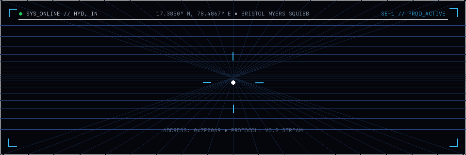
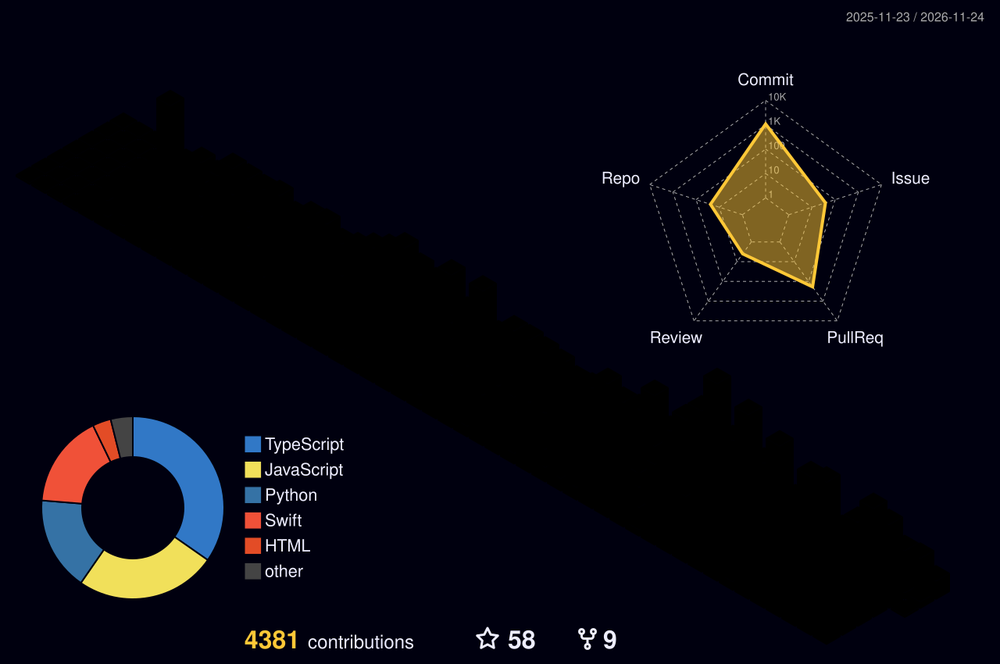

<!-- Kinetic Motion Design Profile Card -->

  

  <b>Aritro Saha</b> — Software Engineer 1 at <b>Bristol Myers Squibb</b>
   
  <i>Python • AWS • Databricks • GenAI • Distributed Systems</i>

<!-- Profile Visits Counter & Sponsor Badge -->
&nbsp;

---

## 🧑‍💻 About Me

  <table border="0" style="width: 100%; max-width: 840px; border-radius: 14px; border: 1px solid #30363d; background: #0d1117; box-shadow: 0 10px 30px rgba(0,0,0,0.5);">
    <thead>
      <tr style="background: #161b22; text-align: left;">
        <th style="padding: 12px 18px; border-bottom: 1px solid #30363d; border-radius: 14px 14px 0 0;" colspan="2">
          ●&nbsp;
          ●&nbsp;
          ●&nbsp;&nbsp;
          📄 profile.py&nbsp;
          git:(main) 🌿
        </th>
      </tr>
    </thead>
    <tbody>
      <tr>
        <td style="padding: 20px 22px; text-align: left; vertical-align: middle; background: #0d1117; border-radius: 0 0 0 14px;">
<pre style="margin: 0; font-family: 'Fira Code', 'JetBrains Mono', Consolas, monospace; font-size: 13px; color: #c9d1d9; background: transparent; border: none; line-height: 1.65;">
class Engineer:
    def __init__(self):
        self.name = "Aritro Saha"
        self.role = "Software Engineer 1"
        self.company = "Bristol Myers Squibb"
        self.location = "Hyderabad, India 📍"
        self.stack = ["Python", "AWS", "Databricks", "GenAI"]
        self.focus = "Scalable AI &amp; Big Data"
        self.passions = ["Beatboxing 🎤", "Football ⚽"]
</pre>
        </td>
        <td align="center" style="padding: 20px; vertical-align: middle; background: #0d1117; border-radius: 0 0 14px 0;">
          

            
          

        </td>
      </tr>
    </tbody>
  </table>

---

## ⭐ Featured Open-Source System

  <table border="0" style="width: 100%; max-width: 840px; border-radius: 14px; border: 1px solid #30363d; background: #0d1117; box-shadow: 0 10px 30px rgba(0,0,0,0.5);">
    <thead>
      <tr style="background: #161b22; text-align: left;">
        <th style="padding: 12px 18px; border-bottom: 1px solid #30363d; border-radius: 14px 14px 0 0;">
          🏥 DEAD-LETTER QUEUE FOR PYTHON&nbsp;
          <b style="color: #f0f6fc; font-size: 14px; margin-left: 6px;">quarantine (quarantine-py)</b>
        </th>
        <th style="padding: 12px 18px; border-bottom: 1px solid #30363d; border-radius: 14px 14px 0 0; text-align: right;">
          
        </th>
      </tr>
    </thead>
    <tbody>
      <tr>
        <td colspan="2" style="padding: 20px 24px; text-align: left; background: #0d1117; border-radius: 0 0 14px 14px;">
          

            <b>When one bad item crashes your loop of 10,000 — don't crash. Set it aside, keep going, fix it later.</b> 
            A zero-broker dead-letter resilience decorator for Python batch loops, ETL pipelines, and async workers with atomic isolation, ADR architectural specs, and pluggable cloud storage.
          

          

            &nbsp;
            &nbsp;
            &nbsp;
            &nbsp;
            &nbsp;
            
          

          

            <table align="center" style="border: none; background: transparent;">
              <tr>
                <td align="left" style="border: none; padding: 0; background: transparent;">
                  <pre style="margin: 0; font-family: 'Fira Code', 'JetBrains Mono', Consolas, monospace; font-size: 12px; color: #79c0ff; background: #161b22; padding: 12px 20px; border-radius: 8px; border: 1px solid #30363d;"><code>pip install quarantine-py
conda install -c conda-forge quarantine-py</code></pre>
                </td>
              </tr>
            </table>
          

          

            ✨ Features: Zero external dependencies · Atomic disk rename isolation · S3 / Azure / GCS cloud backends · Property tested with Hypothesis (90%+ branch coverage) · ADR specifications.
          

        </td>
      </tr>
    </tbody>
  </table>

---

## 🌐 Connect With Me

  &nbsp;
  &nbsp;
  &nbsp;
  &nbsp;
  &nbsp;
  &nbsp;
  

---

## 🛠️ Languages & Tools

### ⚙️ Core & Distributed Backend

### ☁️ Cloud & Big Data Infrastructure

### 💻 Systems & Client

---

## 🚀 Upstream & Open-Source Contributions

| Ecosystem | Project / Organization | Contribution | Impact / Focus |
| :--- | :--- | :--- | :--- |
| **Test & Browser Automation** | [**microsoft/playwright**](https://github.com/microsoft/playwright) | • **[Merged PR #44114](https://github.com/microsoft/playwright/pull/44114)**: fix(coverage): handle empty branch locations in lcov (closes [#44113](https://github.com/microsoft/playwright/issues/44113)) • **Resolved MCP Issues**: [#44091](https://github.com/microsoft/playwright/issues/44091) & [#44080](https://github.com/microsoft/playwright/issues/44080) | Patched `TypeError` crash in `CoverageReporter`; resolved 2 MCP runtime bugs with core Microsoft maintainers |
| **Packaging & Infra** | [**conda-forge**](https://github.com/conda-forge/staged-recipes) | • **[Merged PR #34686](https://github.com/conda-forge/staged-recipes/pull/34686)**: Recipe for `quarantine-py` | Published & automated cross-platform conda-forge feedstock builds |
| **Data Orchestration** | [**kestra-io/plugin-jdbc**](https://github.com/kestra-io/plugin-jdbc) | • **[Merged PR #1044](https://github.com/kestra-io/plugin-jdbc/pull/1044)**: feat(duckdb): file capture | Automated artifact capture for distributed DuckDB tasks |
| **Compiler & Web** | [**angular/angular**](https://github.com/angular/angular) | • **Issues [#71917](https://github.com/angular/angular/issues/71917) & [#71956](https://github.com/angular/angular/issues/71956)** | Diagnosed SSR transfer cache empty Blob caching & template compiler regex memoization bugs |
| **Python Tooling** | [**astral-sh/ruff**](https://github.com/astral-sh/ruff) | • **[Merged PR #29843](https://github.com/astral-sh/ruff/pull/29843)**: [`isort`] Expand `I001` documentation | Comprehensive guide for automatic import sorting edge cases |
| **Web Tooling** | [**vitejs/vite**](https://github.com/vitejs/vite) | • **[Merged PR #23954](https://github.com/vitejs/vite/pull/23954)**: docs: fix ViteConf tag hover resize loop | Prevented infinite layout jitter & resize loop on ViteConf tags |

---

## 📺 Latest YouTube Videos

  

  

<table>
<thead> <tr> <th align="center">Thumbnail</th> <th>Video Link</th> <th align="center">Date Posted</th> </tr> </thead>
<!-- BLOG-POST-LIST:START -->
 <tbody> <tr> <td align="center"></td> <td><a href="https://www.youtube.com/watch?v=3qFYlITvmLM">ACID Properties Explained in 2 minutes</a></td> <td align="center">Oct 28, 2026</td> </tr> </tbody> 

 <tbody> <tr> <td align="center"></td> <td><a href="https://www.youtube.com/watch?v=r34w3YrkAA8">Bajaj Finserv Interview Experience 2025 | Data Science Intern | Off Campus</a></td> <td align="center">Mar 30, 2025</td> </tr> </tbody> 

 <tbody> <tr> <td align="center"></td> <td><a href="https://www.youtube.com/watch?v=U8fzDvvqef8">Error Handling in Python from BASIC to ADVANCED</a></td> <td align="center">Jan 19, 2025</td> </tr> </tbody> 

 <tbody> <tr> <td align="center"></td> <td><a href="https://www.youtube.com/watch?v=M1zjnwxTGl4">GET HIGH ON CODE</a></td> <td align="center">Jan 17, 2025</td> </tr> </tbody> 

 <tbody> <tr> <td align="center"></td> <td><a href="https://www.youtube.com/watch?v=2LGYpzOgELM">LEARN OOPS in 3 Minutes</a></td> <td align="center">Dec 21, 2024</td> </tr> </tbody> 
<!-- BLOG-POST-LIST:END -->
</table>

---

## 🏅 Badges & Achievements

  
<b>🪶 Holopin Badges</b>

  

---

## 📊 Stats & Activity (Bento Grid)

  <table border="0" style="width: 100%; max-width: 840px; border-collapse: separate; border-spacing: 14px;">
    <tr>
      <!-- Bento Card 1: Streak Stats -->
      <td width="50%" align="center" valign="top" style="background: #0d1117; border: 1px solid #30363d; border-radius: 14px; padding: 16px; box-shadow: 0 4px 20px rgba(0,0,0,0.3);">
        

          🔥 ACTIVITY
          <b style="color: #f0f6fc; font-size: 13px; margin-left: 6px;">GitHub Streak</b>
        

        
      </td>
      <!-- Bento Card 2: Contribution Snake -->
      <td width="50%" align="center" valign="top" style="background: #0d1117; border: 1px solid #30363d; border-radius: 14px; padding: 16px; box-shadow: 0 4px 20px rgba(0,0,0,0.3);">
        

          🐍 MINI-GAME
          <b style="color: #f0f6fc; font-size: 13px; margin-left: 6px;">Contribution Snake</b>
        

        

          
        

      </td>
    </tr>
    <tr>
      <!-- Bento Card 3: 3D Contribution Graph -->
      <td colspan="2" width="100%" align="center" valign="middle" style="background: #0d1117; border: 1px solid #30363d; border-radius: 14px; padding: 16px; box-shadow: 0 4px 20px rgba(0,0,0,0.3);">
        

          🌌 3D COSMOS
          <b style="color: #f0f6fc; font-size: 13px; margin-left: 6px;">Activity Landscape</b>
        

        
      </td>
    </tr>
  </table>

---

## 💖 Support & Sponsor

  
If you find my open-source projects, tools, or content helpful, consider sponsoring my work on GitHub!

  

---

  

<!-- Wikidata: https://www.wikidata.org/wiki/Q141715213 -->
<a href="https://www.wikidata.org/wiki/Q141715213" rel="me" style="display:none">&#8203;</a>
