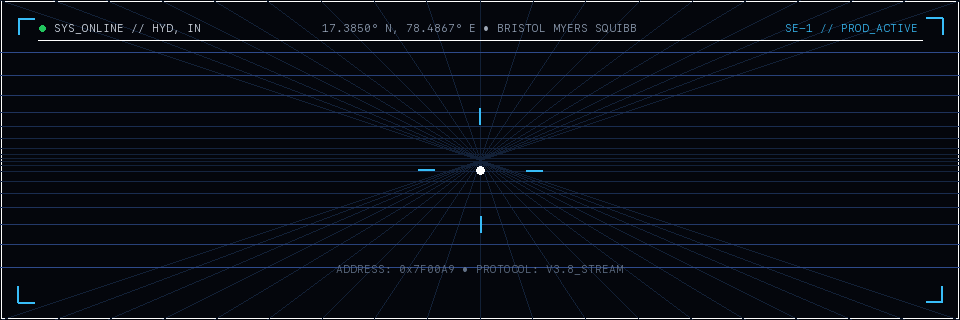
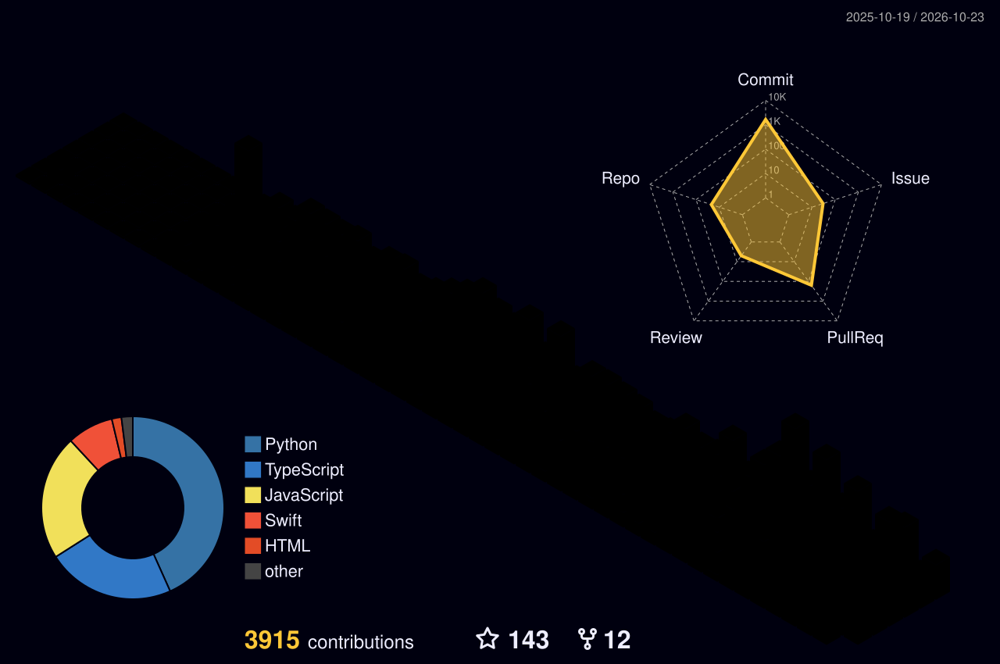

<!-- Kinetic Motion Design Profile Card -->

  

<!-- Profile Visits Counter & Sponsor Badge -->
&nbsp;

  <b>Aritro Saha</b> — Software Engineer 1 at <b>Bristol Myers Squibb</b>
   
  <i>Python • AWS • Databricks • GenAI • Full-Stack</i>

---

## 🧑‍💻 About Me

  <table border="0" style="width: 100%; max-width: 840px; border-radius: 14px; border: 1px solid #30363d; background: #0d1117; box-shadow: 0 10px 30px rgba(0,0,0,0.5);">
    <thead>
      <tr style="background: #161b22; text-align: left;">
        <th style="padding: 12px 18px; border-bottom: 1px solid #30363d; border-radius: 14px 14px 0 0;" colspan="2">
          ●&nbsp;
          ●&nbsp;
          ●&nbsp;&nbsp;
          📄 profile.py&nbsp;
          git:(main) 🌿
        </th>
      </tr>
    </thead>
    <tbody>
      <tr>
        <td style="padding: 20px 22px; text-align: left; vertical-align: middle; background: #0d1117; border-radius: 0 0 0 14px;">
<pre style="margin: 0; font-family: 'Fira Code', 'JetBrains Mono', Consolas, monospace; font-size: 13px; color: #c9d1d9; background: transparent; border: none; line-height: 1.65;">
class Engineer:
    def __init__(self):
        self.name = "Aritro Saha"
        self.role = "Software Engineer 1"
        self.company = "Bristol Myers Squibb"
        self.location = "Hyderabad, India 📍"
        self.stack = ["Python", "AWS", "Databricks", "GenAI"]
        self.focus = "Scalable AI &amp; Big Data"
        self.passions = ["Beatboxing 🎤", "Football ⚽"]
</pre>
        </td>
        <td align="center" style="padding: 20px; vertical-align: middle; background: #0d1117; border-radius: 0 0 14px 0;">
          

            
          

        </td>
      </tr>
    </tbody>
  </table>

---

## 🌐 Connect With Me

  &nbsp;
  &nbsp;
  &nbsp;
  &nbsp;
  &nbsp;
  &nbsp;
  

---

## 🛠️ Languages & Tools

### ⚙️ Backend & Data

### 🎨 Frontend

### 🗄️ Databases & Cloud

### 🔧 Tools & OS

---

## 📺 Latest YouTube Videos

  

  

<table>
<thead> <tr> <th>Thumbnail</th> <th>Video Link</th> <th>Date Posted</th> </tr> </thead>
<!-- BLOG-POST-LIST:START -->
 <tbody> <tr> <td></td> <td><a href="https://www.youtube.com/watch?v=r34w3YrkAA8">Bajaj Finserv Interview Experience 2025 | Data Science Intern | Off Campus</a></td> <td>Mar 30, 2025</td> </tr> </tbody> 

 <tbody> <tr> <td></td> <td><a href="https://www.youtube.com/watch?v=U8fzDvvqef8">Error Handling in Python from BASIC to ADVANCED</a></td> <td>Jan 19, 2025</td> </tr> </tbody> 

 <tbody> <tr> <td></td> <td><a href="https://www.youtube.com/watch?v=M1zjnwxTGl4">GET HIGH ON CODE</a></td> <td>Jan 17, 2025</td> </tr> </tbody> 

 <tbody> <tr> <td></td> <td><a href="https://www.youtube.com/watch?v=2LGYpzOgELM">LEARN OOPS in 3 Minutes</a></td> <td>Dec 21, 2024</td> </tr> </tbody> 

 <tbody> <tr> <td></td> <td><a href="https://www.youtube.com/watch?v=2u19wN1tDT4">APIs Explained in Under 2 Minutes</a></td> <td>Dec 16, 2024</td> </tr> </tbody> 
<!-- BLOG-POST-LIST:END -->
</table>

---

## 🏅 Badges & Achievements

  
<b>🪶 Holopin Badges</b>

  

---

## 📊 Stats & Activity (Bento Grid)

  <table border="0" style="width: 100%; max-width: 900px; border-collapse: separate; border-spacing: 14px;">
    <tr>
      <!-- Bento Card 1: Streak Stats -->
      <td width="50%" align="center" valign="middle" style="background: #0d1117; border: 1px solid #30363d; border-radius: 14px; padding: 16px; box-shadow: 0 4px 20px rgba(0,0,0,0.3);">
        

          🔥 ACTIVITY
          <b style="color: #f0f6fc; font-size: 13px; margin-left: 6px;">GitHub Streak</b>
        

        
      </td>
      <!-- Bento Card 2: LeetCode -->
      <td width="50%" align="center" valign="middle" style="background: #0d1117; border: 1px solid #30363d; border-radius: 14px; padding: 16px; box-shadow: 0 4px 20px rgba(0,0,0,0.3);">
        

          🧩 PROBLEM SOLVING
          <b style="color: #f0f6fc; font-size: 13px; margin-left: 6px;">LeetCode Analytics</b>
        

        
      </td>
    </tr>
    <tr>
      <!-- Bento Card 3: 3D Contribution Graph -->
      <td width="50%" align="center" valign="middle" style="background: #0d1117; border: 1px solid #30363d; border-radius: 14px; padding: 16px; box-shadow: 0 4px 20px rgba(0,0,0,0.3);">
        

          🌌 3D COSMOS
          <b style="color: #f0f6fc; font-size: 13px; margin-left: 6px;">Activity Landscape</b>
        

        
      </td>
      <!-- Bento Card 4: Contribution Snake -->
      <td width="50%" align="center" valign="middle" style="background: #0d1117; border: 1px solid #30363d; border-radius: 14px; padding: 16px; box-shadow: 0 4px 20px rgba(0,0,0,0.3);">
        

          🐍 MINI-GAME
          <b style="color: #f0f6fc; font-size: 13px; margin-left: 6px;">Contribution Snake</b>
        

        
      </td>
    </tr>
  </table>

---

## 💖 Support & Sponsor

  
If you find my open-source projects, tools, or content helpful, consider sponsoring my work on GitHub!

  

 

---

  

<!-- Wikidata: https://www.wikidata.org/wiki/Q141715213 -->
<a href="https://www.wikidata.org/wiki/Q141715213" rel="me" style="display:none">&#8203;</a>
